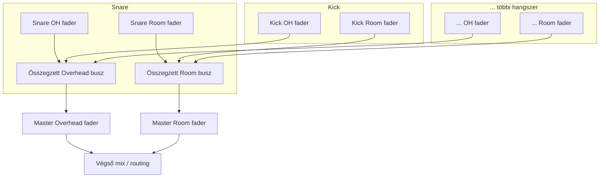

# 4. Mixing és routing

## 4.1 Csatornánkénti faderek (hangszer szintjén)

Minden hangszer minden mikrofoncsatornájához **külön fader** tartozik, az adott
hangszer editor-paneljében (nem globális kontroll). Példa — Snare, Heavy sáv:

| Csatorna | Fader |
|---|---|
| Top (spot) | 0 dB |
| Bottom (spot) | −4 dB |
| Overhead L/R | −8 dB |
| Room L/R | −10 dB |

- Ez a fader-csoport **csak az adott hangszerre** hat, mielőtt a jel a közös
  overhead/room gyűjtőbuszba kerülne (lásd 4.3).
- A fader-értékek a preset részét képezik (lásd [06-preset-format.md](06-preset-format.md)).
- Dupla kattintással, illetve `Cmd`/`Ctrl` + kattintással bármely csatorna- vagy
  master fader azonnal **0,0 dB** értékre áll vissza.
- Külön mono Overhead/Room csatornák esetén az `L` csatorna alapból hard left
  (`L100`), az `R` csatorna hard right (`R100`) panorámát kap.
- Ha az Overhead vagy Room egyetlen stereo fájl/csatorna, egy közös faderrel és
  route-tal jelenik meg; a stereo kép belső L/R elrendezését az alkalmazás megőrzi.
- A Global Mixer minden mono Spot csatornájához külön `L100 … C … R100` pan
  csúszka tartozik. Dupla kattintással a pan középre (`C`) áll vissza. Stereo
  csatornánál nincs pan csúszka, így annak belső sztereó képe változatlan marad.

## 4.2 Kimeneti routing mátrix

- Kontakt-szerű routing táblázat: minden hangszer minden mikrofoncsatornájához
  kiválasztható, hogy **melyik plugin-kimeneti buszra** menjen (lásd
  [01-architecture.md](01-architecture.md) 1.4 pont a busz-layout javaslatért).
- Alapértelmezett routing: spot csatornák → saját dedikált buszuk (pl. Snare Top
  → "Snare Top" busz), overhead csatornák → közös "Overheads" busz, room csatornák
  → közös "Room" busz — de bármelyik csatorna átirányítható bármelyik buszra,
  vagy összevonható a "Master" stereo buszba.
- Ha egy csatorna kiválasztott busza az adott munkamenetben nem rendelkezik
  valódi kimeneti csatornákkal — akár mert a host nincs multi-out módban,
  akár mert (pl. Standalone-ban egy sima sztereó eszközzel) a host
  egyáltalán nem ad ennyi buszt —, az a csatorna automatikusan a belső
  stereo `Master` mixbe esik vissza a beállított faderekkel és pan-nal
  (`DrumEngine::triggerNoteOn`).

## 4.3 Közös overhead/room master fader-csoport

A hangszerenkénti faderek (4.1) **nem helyettesítik**, hanem **megelőzik** ezt a
réteget:

- A **Master Overhead** és **Master Room** faderek egyetlen globális kontrollként
  együtt szabályozzák **az összes hangszer** overhead, illetve room hozzájárulását —
  pl. egy gyors "kevesebb room az egész kiten" döntéshez nem kell hangszerenként
  külön-külön állítani.
- Ez a két fader **a globális beállítások panelen** él (nem hangszer-specifikus),
  és a routing mátrixtól függetlenül mindig hat, amennyiben az adott csatorna a
  belső OH/Room gyűjtőbuszba van irányítva (ha egy csatorna külön dedikált buszra
  van routolva a host felé, a master OH/Room fader nem érvényesül rá — hiszen
  akkor a keverés a host mixerében történik).
- Spot csatornákra a master OH/Room fadereknek nincs hatása — azokhoz a
  hangszerenkénti fader (4.1) és a saját routing tartozik.

## 4.4 Master fader

- A teljes plugin kimenetére ható végső fader (post-routing): **minden**
  betöltött kimeneti buszra hat, a belső stereo mixdown útra csakúgy, mint a
  dedikált multi-out buszokra — nem csak a `bus:Master` route-ra. Nem
  helyettesíti, hanem tetézi a csatorna-/busz-szintű routingot: egy gyors
  "az egész kit legyen halkabb" döntéshez nem kell minden busz saját
  faderét egyenként állítani.
